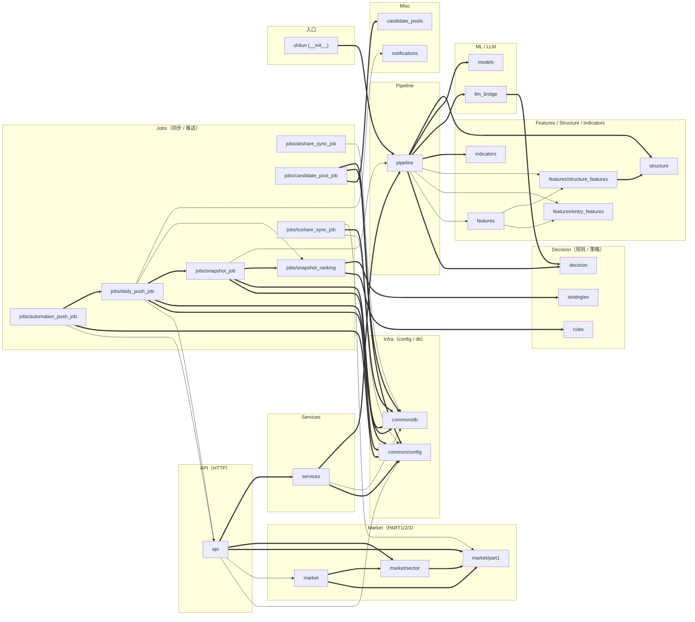

# 石论项目代码依赖分析报告

> 基于 [CodeGraph v1.1.1](https://github.com/colbymchenry/codegraph) 索引（2026-06-27）
>
> 索引位置：`.codegraph/codegraph.db`（5.3 MB SQLite）

---

## 一、索引总览

| 指标 | 数值 |
|---|---|
| 已索引文件 | 73（仅项目代码，已排除 `.venv312`/`_future`） |
| 节点总数 | 1,698 |
| 边总数 | 5,257 |
| 模块级 import 关系 | **46 条**（去重后） |
| 二点循环依赖 | **0 对** ✅ |
| 三点循环依赖 | **0 个** ✅ |
| 索引耗时 | 1.2 秒 |

**Python 文件分布：61 个，主力包含：**
- `shilun/api/` — HTTP 路由（**20 个 endpoint**）
- `shilun/jobs/` — 数据同步与日报推送（**8 个 job**）
- `shilun/market/` — PART1/2/3 三层交易引擎（**5 个文件**）

---

## 二、依赖关系图（按层聚类）



**图例**：`==>` 表示强依赖（≥3 个 import 点），`-->` 表示弱依赖（1-2 个）。

---

## 三、关键发现

### 3.1 上帝模块（被依赖最多）

| 排名 | 模块 | 被依赖次数 | 角色 |
|---|---|---|---|
| 1 | **`shilun.common.config`** | 7 | 配置中心（合理） |
| 2 | **`shilun.common.db`** | 6 | Mongo 访问层（合理） |
| 3 | **`shilun.market.part1`** | 4 | PART1 大盘引擎（合理） |
| 4 | **`shilun.pipeline`** | 3 | 单票分析主管道 |
| 5 | `shilun.market.sector` | 2 | PART2 板块引擎 |

`common.config` + `common.db` 是典型基础设施，被依赖多是正常的。**没有出现业务模块被反向依赖的反模式。**

### 3.2 上帝模块（依赖最多 / out-degree）

| 排名 | 模块 | 依赖他人次数 | 关注度 |
|---|---|---|---|
| 1 | **`shilun.pipeline`** | 8 | ⚠️ 应警惕 |
| 2 | **`shilun.jobs.daily_push_job`** | 6 | ⚠️ 上帝 job |
| 3 | **`shilun.api`** | 5 | ⚠️ 单文件 1507 行 + 20 路由 |
| 4 | `shilun.jobs.snapshot_job` | 4 | 可接受 |
| 5 | `shilun.jobs.automation_push_job` 等 | 3 | 可接受 |

**风险提示：**
- `shilun/api/__init__.py` **单文件 1507 行 + 20 个 HTTP 路由 + 72 个符号**。建议拆成 `api/market_routes.py` / `api/data_routes.py` / `api/telegram_routes.py` 等子模块。
- `shilun/pipeline.py` 拉了 8 个子系统，是真正的"分析总管道"，目前合理但要警惕进一步膨胀。
- `daily_push_job` 几乎对接所有数据源 — 这是日报的本性，但意味着任何一个 job 变更都可能波及日报。

### 3.3 文件复杂度 Top 10（符号数）

| 文件 | 符号数 | 说明 |
|---|---|---|
| `static/app.js` | 110 | 前端 — 单文件偏大但 SPA 结构合理 |
| `models/__init__.py` | 85 | ML 模型层入口 |
| **`common/db.py`** | 77 | ⚠️ Mongo 全部读写在一个文件 |
| **`api/__init__.py`** | 72（被解析的） | ⚠️ 应拆分 |
| **`market/part1.py`** | 64 | PART1 + 波浪分析 + 形态识别 |
| `pipeline.py` | 56 | 主管道 |
| `structure/__init__.py` | 48 | 结构特征 |
| `market/sector.py` | 44 | PART2 板块引擎 |
| `decision/__init__.py` | 44 | 决策引擎 |
| `jobs/tushare_sync_job.py` | 25 | Tushare 同步 |

### 3.4 循环依赖

**零循环依赖。** ✅

二点环 (A ⇄ B)：**0 对**
三点环 (A → B → C → A)：**0 个**

说明分层清晰，没有反向引用。

### 3.5 看似"孤立"实为延迟加载的模块

CodeGraph 默认不识别**函数内 import**（用于规避循环依赖或可选依赖），下列模块被错标"孤立"，但实际有用：

| "孤立"模块 | 实际引用位置 | 备注 |
|---|---|---|
| `shilun.market.candidates` | `sector.py:262` 函数内 | PART3 候选池构建 |
| `shilun.market.wave_doc_parser` | `api/__init__.py:1037` 函数内 | 波浪文档解析 |
| `shilun.__main__` | 入口脚本 | `python -m shilun` |
| `shilun.common`、`shilun.config`、`shilun.jobs` | 仅 `__init__.py` 命名空间 | 包定义 |

**这本身不是问题**，但说明项目里有"避免循环依赖的 lazy import"模式，迁移/重构时需注意。

---

## 四、HTTP 路由清单（20 个 endpoint）

全部在 `shilun/api/__init__.py`：

| 行号 | 方法 | 路径 | 用途 |
|---|---|---|---|
| 154 | GET | `/` | 控制台首页 |
| 155 | GET | `/ui` | 控制台首页 |
| 172 | GET | `/api/v1/push-channel/status` | 飞书/Telegram 健康 |
| 186 | GET | `/api/v1/tushare/health` | Tushare 网关健康 |
| 335 | GET | `/api/v1/data/status` | **全数据源状态**（核心 + 增强）|
| 562 | GET | `/api/v1/market/permission` | PART1 大盘权限（含缓存） |
| 666 | GET | `/api/v1/market/sectors` | PART2 板块动向 |
| 734 | GET | `/api/v1/market/candidates` | PART3 候选池 |
| 807 | GET | `/api/v1/market/leaders` | 龙头榜 |
| 872 | POST | `/api/v1/data/sync` | Tushare 同步（4 mode） |
| 963 | POST | `/api/v1/data/sync-akshare` | akshare 增强同步 |
| 1027 | POST | `/api/v1/market/upload-wave-doc` | **波浪文档导入** |
| 1082 | GET | `/api/v1/market/wave-docs` | 文档列表 |
| 1104 | DELETE | `/api/v1/market/wave-docs` | 删除文档 |
| 1124 | POST | `/api/v1/daily-push` | 日报推送 |
| 1155 | GET | `/api/v1/analyze` | 单票分析 |
| 1310 | GET | `/api/v1/telegram/analyze` | TG 单票分析 |
| 1328 | GET | `/api/v1/telegram/get-me` | TG 状态 |
| 1339 | POST | `/api/v1/telegram/set-webhook` | TG webhook 配置 |
| 1361 | POST | `/api/v1/telegram/webhook` | TG webhook 接收 |

**拆分建议（如果要做）：**
- `api/system_routes.py`：push-channel/status、tushare/health、data/status
- `api/data_routes.py`：data/sync、data/sync-akshare、market/wave-docs（CRUD）
- `api/market_routes.py`：market/permission、market/sectors、market/candidates、market/leaders、market/upload-wave-doc
- `api/telegram_routes.py`：所有 telegram/*
- `api/analyze_routes.py`：analyze、daily-push

---

## 五、函数热度榜（被调用最多）

| 调用次数 | 函数 | 文件 |
|---|---|---|
| 241 | `escapeHtml` | static/app.js |
| 110 | **`_round`** | market/part1.py |
| 109 | **`_float`** | market/sector.py |
| 96 | **`_float`** | market/part1.py |
| 76 | **`_round`** | market/sector.py |
| 39 | `_clip` | features/entry_features.py |
| 36 | `_as_float` | pipeline.py |
| 32 | `_coalesce` | models/__init__.py |
| 31 | `_trap` | features/entry_features.py |
| 29 | `_text` | pipeline.py |

**观察：** `_float` 和 `_round` 在 `part1.py` 和 `sector.py` 各自定义了一份 — 这是**重复的工具函数**，应统一提到 `shilun.common.utils`（约能去重 ~200 次调用）。

---

## 六、子包文件分布

| 子包 | 文件数 | 占比 |
|---|---|---|
| `shilun/jobs` | 8 | 13% |
| `shilun/market` | 5 | 8% |
| `shilun/features` + `shilun/common` | 3+3 | 10% |
| `shilun` (root: `__init__`、`__main__`、`pipeline`) | 3 | 5% |
| 其余各包（`api/services/decision/...`）| 各 1 | 各 1.6% |

**多数子包只有一个 `__init__.py`**，说明项目目前**按命名空间组织而非按文件**。后续如果模块逻辑膨胀，可在子包内拆出多个 `.py`。

---

## 七、架构观察

### ✅ 做得好

1. **分层清晰**：基础设施（infra）→ 业务（market/pipeline）→ 接口（api/jobs）单向依赖，零循环
2. **PART1/2/3 关系正确**：`market → market/sector → market/part1` 单向，sector 依赖 part1（板块需要先知道大盘）
3. **Jobs 互相协作合理**：daily_push 依赖 snapshot_job，automation_push 依赖 daily_push（嵌套合理）
4. **基础设施统一**：所有 job 都走 `common/db` + `common/config`，无散点访问

### ⚠️ 需要注意

| 问题 | 位置 | 建议 |
|---|---|---|
| 上帝路由文件 | `api/__init__.py` 1507 行 / 20 endpoint | 按业务拆 5 个子模块 |
| 工具函数重复 | `_float`/`_round` 在 part1 + sector 各定义 | 提到 `common/utils.py` |
| Mongo 写入集中 | `common/db.py` 77 个符号 | 按 dataset 拆 `db/sync_state.py` 等 |
| 函数内 lazy import | 6 个模块（candidates、wave_doc_parser 等） | 检查是否有遗留的循环依赖隐患 |

### 📊 与传统分析工具对比

| 维度 | CodeGraph | pydeps | pyan3 |
|---|---|---|---|
| 增量更新 | ✅ FSEvents 自动 | ❌ 一次性 | ❌ 一次性 |
| 调用边（不只 import） | ✅ | ❌ | ✅ |
| MCP 接入 AI agent | ✅ | ❌ | ❌ |
| 多语言（含 JS） | ✅ 20+ | Python only | Python only |
| 数据库可查询 | ✅ SQLite | ❌ | ❌ |

---

## 八、附录：CodeGraph CLI 使用速查

```bash
# 项目根目录运行
cd ~/shilun_standalone

# 查询符号 / 模块
codegraph node "shilun/market/part1.py"        # 单文件全貌 + 被谁引用
codegraph node evaluate_market_permission       # 单函数定义 + 调用栈
codegraph query "wave"                          # 全文搜索 "wave" 相关符号

# 影响分析
codegraph callers _build_pattern_forecast       # 谁调了这个函数
codegraph callees evaluate_market_permission    # 这个函数调了谁
codegraph impact <symbol>                       # 改这个符号会影响哪些下游
codegraph affected <changed-file>               # 改这个文件会影响哪些测试

# 探索（给 AI agent 用）
codegraph explore "波浪分析逻辑"                # 一次性返回相关源码 + 调用路径

# 索引管理
codegraph status                                # 看索引统计
codegraph sync                                  # 增量同步（默认自动）
codegraph index                                 # 重建全量索引
```

通过 MCP 已接入 Claude Code：下次新开 session 会自动有 `codegraph_explore`、`codegraph_node` 等工具可用。
