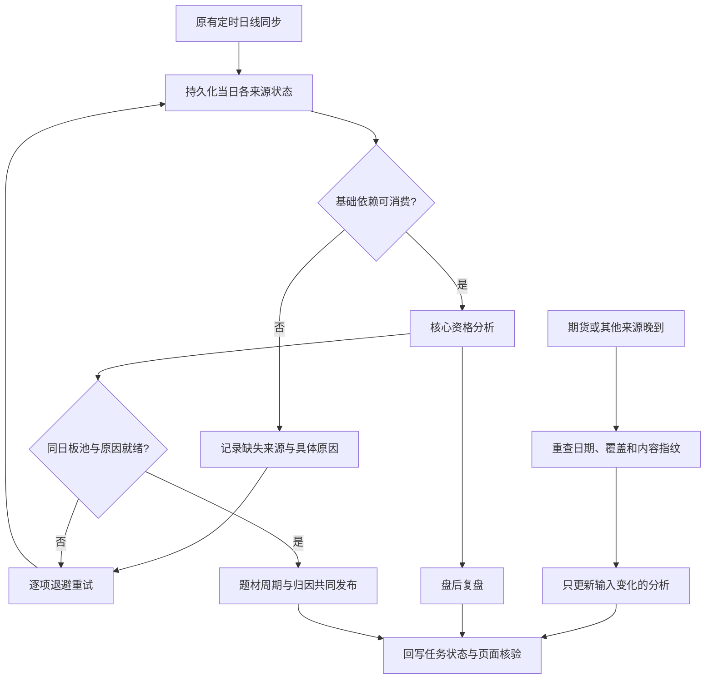

# 数据依赖、分析与逐项重试闭环

2026-11-03。替代“定时抓一次，再把当时失败提示永久写入页面”的行为。

## 状态与边界

- `ready` 表示可被指定分析模块消费；`complete` 表示来源完整；`needs_retry` 表示还需要修复。这三个含义不能混用。
- 交易日历、当日日线、昨日日线及有效涨跌停价不足时，等待必要输入；行业完全缺失时不生成核心与复盘，零星行业缺口保留降级。
- 同日涨停／炸板收盘池和同日涨停原因是题材周期依赖；未齐时保留上一完整周期。
- 期货、资金、竞价、停复牌、龙虎榜等分来源核验。期货缺失只降级机构旁证；部分可用但未完整的可修复来源继续有界重试。
- 昨日固定涨停名单与当日日线可用时，不再为一个可选的昨日表现接口无限补数。
- 不调用已退出的旧 `sync_perspectives` 排名派生；行业分类与涨停原因事件题材分别准备。

## 持久化与恢复

`data_pipeline_tasks` 按交易日＋阶段唯一保存状态、尝试次数、阻断依赖、下一次重试时间、脱敏错误、输入及输出修订。等待依赖不消耗尝试次数。失败按5／15／30／60分钟退避，共最多5次；耗尽后明确停止自动重试。输入确实变化时开启新预算。

长同步执行前记录intent。运行任务有2小时恢复期限，匹配现有全局流水线租约；崩溃到期后记录中断并恢复退避。重试与完整流水线共享全局租约，调度器在同一执行器串行处理；期货、板池及心跳仍独立。

成功清除当前错误及重试时间，保留有限的脱敏历史。新一轮回执清空旧错误字段。历史日的修复只更新该日回执，不能覆盖较新的latest状态。

## 分析复用与晚到数据

每5分钟运行 `python -m shilun.jobs.data_pipeline_retry_job`。它观察已登记日期和最新分析日，不启动完整全市场同步。只对到期的缺失来源执行修复，成功后重新读取实际归档核验，不能凭抓取成功回执放行。

分析输入内容指纹相同则复用已完成结果。期货晚到只更新复盘；历史题材原因补齐只更新题材消费链；核心实际120交易日行情、涨停价、停牌及资格元数据变化才重新认证核心。历史指纹只读，不自动启动120日大规模回补。主题历史按已验收基线／context窗口读取；无法读取基线时明确使用最近120个已核验交易日的有限窗口。

120日历史使用流式内容指纹，控制内存。每轮复核缓存历史指纹，单源修复内部不重复扫描120日；涉及历史行情或原因修复时才重读对应窗口。经本机Mongo隧道读取完整历史开销较大，运行任务应放在ECS本地Mongo旁执行。

## 页面与运维入口

- 复盘GET只读当日任务状态，不触发下载；数据状态中显示等待项、阻断原因、已尝试次数和北京时间的下一次重试时间。
- `/api/v1/data/status` 提供所选日流水线与任务状态，并保留当前云端调度心跳核验。
- 调度清单新增 `data_pipeline_reconcile`。兼容旧 `topic_perspectives` 数据状态键，同时明确它只是统一分类目录别名。
- 发布指纹覆盖主流水线、重试入口、依赖与可选源适配、任务状态、复盘状态刷新等相关模块。
- 定向核验：`python -m shilun.jobs.data_pipeline_retry_job --date YYYY-MM-DD`。

## 验证记录

最终255项针对性Python测试与4个子测试通过；复盘前端断言通过。覆盖依赖阻断、错误日期、单源重试、最多5次、崩溃恢复、晚到期货、历史指纹变化、历史任务轮转、旧错误清理、历史日不覆盖最新日和空任务无操作。

云端已备份并发布33个文件，逐文件SHA256核验通过。暂存环境43处函数调用签名检查通过；只读生成11月3日复盘通过。实际依赖核查约22.3秒。云端注册15项任务，最终发布指纹为 `6467a9ebd8468be5bf027b914b4f8b1e5cfdfcc9d83bc6cd93a77ea07c742596`，与本地一致。

首轮核心、复盘与题材共同发布完成，复盘生成于21:54:39；停复牌校验作为单项失败进入退避，主体保持降级。第二轮检查51.07秒完成，`changed_stages=[]`，三项消费者尝试次数仍为1，生成时间保持21:54:39，验证了已完成分析的复用。

原停复牌writer将同股票日多事件合并写入，而旧完整性校验却拿原始事件数与股票日缓存数比较，已改为严格事件归一化与实际读回校验，保留混合停复牌事件且不判为全天停牌。失败的结构化源报告同样保存，额外旧缓存不自动失效或删除。

最终实际核验：586个唯一事件，对应584个股票日；写入与读回均584，额外旧缓存0、缺失0、来源与归档指纹一致。单源修复后仅复盘重建，核心及题材均复用；本轮59.27秒完成，待重试任务为空。整体仍降级，因为1只行业映射及少量历史覆盖缺口按事实保留，并非调度未完成。

未触发此前取消的历史情绪回补任务。最终运行证据见 research/evidence/pipeline_closure_20261103/cloud_run_acceptance.json。

本地页面接口最终验收：当日26项任务无待处理；调度心跳enabled、15项实际任务；流水线unavailable_sources为空，仍明确显示行业映射缺口1只。证据见 final_api_status.json。既有 test_review_sept15 中旧DC题材迁移前的pending断言仍需单独更新，不在本次255项针对性通过范围内。

云端代码备份位于 `/opt/shilun-data/releases/pipeline-closure-20261103/`，同时保存host-before与container-before归档。

知识图谱AST数据与报告已更新；HTML可视化因节点超过上限未重新生成。

发布清单：research/evidence/pipeline_closure_20261103/release_manifest.json。
